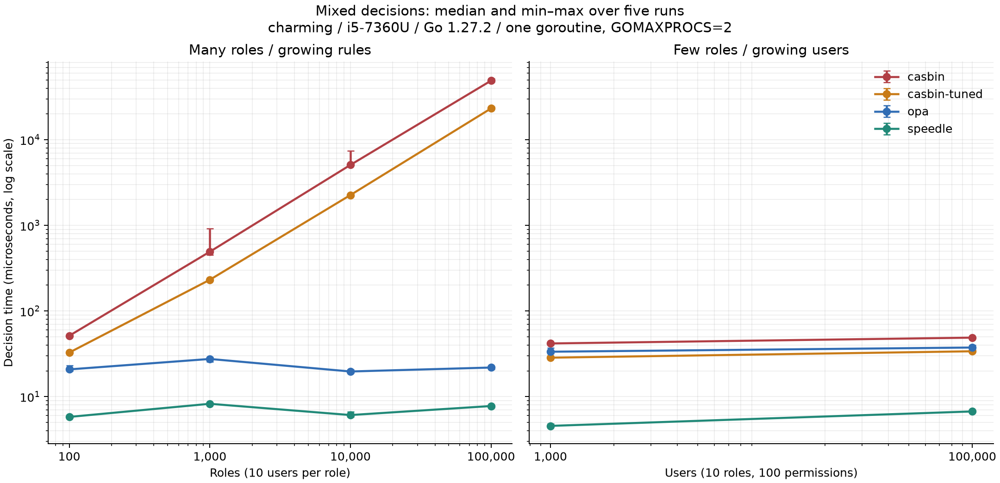
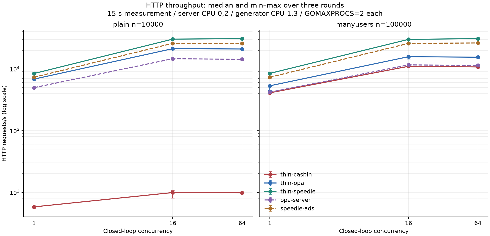

# Measured comparison of the Casbin, OPA, and Speedle+ authorization engines

> English translation of [REPORT.md](REPORT.md), added 2026-11-02. This preserves the archived 2026-10-29 versions, observations, and time-specific statements; it adds no measurements.

Test date: 2026-10-29, Asia/Shanghai. All formal tests were rerun from scratch on charming; this report does not use figures from shrek or older charming runs. The client was the Speedle+ maintainer. The judgments below are based on these observations; defects in pinned versions are distinguished from the project's status at the time of inspection.

> Documentation and ecosystem status refer to snapshots captured at approximately 09:20–09:25 on 2026-10-29. References to current status in the source mean that capture time. During archival, [PR #133](https://github.com/teramoby/speedle-plus/pull/133) was confirmed merged at 10:59 (Asia/Shanghai), updating embedded deployment instructions. That documentation issue is therefore not described as unresolved at archival publication. This later change did not alter pinned versions, measured results, or confirmed runtime behavior.

## 1. Conclusions

**Functionality.** Each engine passed all 30 cases across 9 scenarios. Their data mappings differ; 30/30 establishes decision equivalence for these specific cases, not a ranking of general relationship-authorization capabilities.

**Performance.** For plain mixed requests with 10000 roles/100000 users, median decision latency was Speedle+ 6.093 µs, OPA 19.656 µs, Casbin tuned 2.258 ms, and default Casbin 5.077 ms. For manyusers with few roles and 100000 users, the corresponding values were 6.713 µs, 37.436 µs, 33.845 µs, and 48.837 µs. Both shapes matter. With identical thin HTTP wrappers at concurrency 16, three-round median throughput for plain was Speedle+ 30,373, OPA 21,273, and default Casbin 99 requests/s; for manyusers it was 30,096, 15,766, and 11,012 requests/s.

**Resources.** Loading 100000 roles/1000000 users retained 1024.1 MiB of Go heap for Casbin, 197.2 MiB for OPA, and 500.4 MiB for Speedle+. Loading took 8.551s, 1.819s, and 2.056s respectively. Each was a single loading observation; heap is not total process RSS.

**Usability.** SPDL totaled 51 lines across 9 scenarios, versus 121 for Casbin and 139 for OPA, but repeated model templates and relationship-modeling choices affect that count. Casbin's model/policy separation supports reuse, while matcher order affects performance. OPA's Rego is more general-purpose and requires learning declarative evaluation. On Linux, atomic file replacement terminated the pinned Speedle+ host, and malformed conditions were exposed only during requests; both behaviors matter before using that pinned embedded version.

**Ecosystem.** The query recorded 20473, 12411, and 62 stars, and 173, 625, and 8 historical contributor entries for Casbin, OPA, and Speedle+ respectively. These indicate community scale, not quality scores. At inspection time, Speedle+ v1.6.0 was already recognized by the Go proxy, making the handoff's earlier no-official-Go-release conclusion obsolete.

## 2. Environment and evidence

| Item | Conditions for this run |
|---|---|
| CPU | Intel Core i5-7360U @ 2.30 GHz; 2 physical cores, 4 logical threads |
| Memory and swap | 15 GiB RAM, 2 GiB swap; approximately 10 GiB available initially; approximately 2 GiB swap already in use |
| Disk | APPLE SSD AP0128J NVMe, approximately 113 GiB; /tmp on the root partition, approximately 23 GiB free initially |
| System | Linux Mint 22.3 Zena, based on Ubuntu noble; kernel 7.0.0-38-generic, x86_64 |
| CPU governor / turbo | powersave on all four threads; intel_pstate/no_turbo=0, so turbo was not disabled; system configuration was not changed |
| Build host | shrek.local; Apple M1 Pro, 16 GiB / macOS 27.0.1 (26A434); Go 1.27.2 |
| Build settings | GOOS=linux GOARCH=amd64 CGO_ENABLED=0; no additional performance patches |
| Casbin | github.com/casbin/casbin/v3 v3.11.0 |
| OPA | github.com/open-policy-agent/opa v1.21.4; in-process v1/rego |
| Speedle+ | github.com/teramoby/speedle-plus v0.0.0-20261028230603-b27604c077ce; fixed commit b27604c077ce |
| In-process CPU | Sequential benchmarks: -test.cpu 2; Parallel: 1, 2, 4; no additional taskset restriction, online CPUs 0–3 allowed |
| HTTP CPU | Server taskset 0,2 (two threads of one physical core); load generator taskset 1,3; both GOMAXPROCS=2 |
| Run window | 2026-10-29T09:19:29+08:00 to 2026-10-29T10:17:58+08:00 |
| CI and load | 734 activity samples; maximum Worker count 0; 1-minute load 0.31–3.96; CI-contaminated attempts 0 |
| Paging | Cumulative swap-in increased by 1115 pages and swap-out by 35 pages; pre-existing swap usage and paging during this run are recorded separately |

Full `lscpu`, kernel, governor, disk, memory, binary SHA-256, and `go version -m` output are in [machine.txt](results/retest-20261029/charming/machine.txt). charming did not have Go installed. Module metadata was read on shrek from the same Linux binaries, whose SHA-256 values were then recorded on charming; see [build-info.txt](results/retest-20261029/charming/build-info.txt) and the [compiler-host record](results/retest-20261029/charming/compiler-host.txt).

The same Go source was rebuilt on shrek using the added build script. All six Linux programs had SHA-256 values identical to the binaries actually measured; see [rebuild verification](results/retest-20261029/reproduction-binary-check.json).

Original records: [activity.log](results/retest-20261029/charming/activity.log), [step/retry status](results/retest-20261029/charming/steps.tsv), [run-all.log](results/retest-20261029/charming/run-all.log). Activity was sampled every 5 seconds; each step required no Worker and a 10-second cooldown beforehand. Steps detecting a Worker could be retried up to twice. Sampling cannot exclude activity shorter than 5 seconds. Desktop sessions and other resident processes were retained; other people's processes were not stopped.

## 3. Method

plain: n roles, one permission and 10 users per role; role i can read `/books/bookI`. Sizes were 100, 1000, 10000, and 100000 roles. Each of the four uncached variants at 100000 ran in its own process. ABAC adds two equality conditions per permission; wildcard resources use equivalent `/books/typeI/` prefixes.

manyusers: 10 roles with 10 permissions each, 100 permissions total; user counts were 1000 and 100000. User U belongs to role((U-1)%10+1). Approximately 80% of mixed requests access a book allowed by the user's role; 20% access an adjacent role's book. Additional generator checks used 101 users and all 10 permissions to validate allow/deny behavior; all five variants passed.

Sequential benchmarks used one goroutine and `-test.benchtime 1s -test.count 5 -test.cpu 2`. The CPU option limits Go concurrency; it does not mean a sequential decision used two cores. RBACMixed/ManyUsers cycle through a fixed-seed pool of 4096 requests; very slow variants may cover only a prefix in a measurement. Uncached mixed variants check the first 32 requests before each calibration/measurement; cached variants warm all 4096. Timed loops check actual decisions and errors. Fixed allow/deny requests are also checked before timing. Native request `Prepare` is excluded from in-process decision time; HTTP includes conversion and JSON/network overhead.

| Variant | Meaning |
|---|---|
| casbin | Default matcher checks roles first; Parallel/HTTP use SyncedEnforcer |
| casbin-tuned | Compares resource/action before role lookup; expression order changes, authorization semantics do not |
| casbin-cached | CachedEnforcer using the tuned model; warmed repeated-request hits represent only finite-pool/repeated-request caching |
| casbin-matcher | ABAC conditions in the matcher, compared with default per-rule eval(p.cond) |
| opa | User-role lookup by key, evaluated after PrepareForEval; performance depends on this Rego/data shape |
| speedle | Embedded eval.NewFromFile evaluator; file watching disabled for performance tests |

Latency is the median of five repetitions. Min/max, B/op, and allocs/op are retained in [summary.en.md](results/retest-20261029/charming/summary.en.md). Memory is the retained Go heap increment after two GCs. Original tables say MB but divide by 2^20 bytes; values below are interpreted as MiB. Loading cost was measured once per setting, not as a five-run median.

HTTP used same-host loopback, keep-alive, closed-loop traffic: 5 configurations × 2 datasets × 3 concurrency levels × 3 rounds. Each round completed all configurations before the next. Warmup was 3 seconds and measurement 15 seconds. A service was reused within a round/configuration for concurrency 1/16/64, with fresh warmup at each level; it restarted when configuration or round changed. All services bound only to 127.0.0.1. Speedle+ gRPC was disabled by default; normal/audit logs and OPA logs were error-level. Ports 19000, 18181, and 16735 avoided existing services. Responses fully within the window were checked against expected decisions; boundary-spanning requests were excluded from latency/throughput. `srv cores` and `gen cores` are user+kernel CPU seconds from `/proc/<pid>/stat` divided by wall seconds, with CLK_TCK obtained using getconf. A value of 1.0 means one logical CPU's time on average, not an exclusive physical core.

## 4. Functionality and policy size

| Scenario | Casbin | OPA | Speedle+ |
|---|---|---|---|
| Basic RBAC | 4/4 | 4/4 | 4/4 |
| Role hierarchy | 4/4 | 4/4 | 4/4 |
| Groups | 3/3 | 3/3 | 3/3 |
| Multi-tenant roles | 4/4 | 4/4 | 4/4 |
| ABAC: approval limit | 3/3 | 3/3 | 3/3 |
| ABAC: owner can edit | 3/3 | 3/3 | 3/3 |
| Deny overrides grant | 3/3 | 3/3 | 3/3 |
| Wildcard resources | 3/3 | 3/3 | 3/3 |
| Relationship: doc in (nested) folder | 3/3 | 3/3 | 3/3 |

| Scenario | Casbin lines (chars) | OPA lines (chars) | Speedle+ lines (chars) |
|---|---|---|---|
| Basic RBAC | 15 (267) | 20 (472) | 7 (125) |
| Role hierarchy | 15 (262) | 20 (460) | 8 (140) |
| Groups | 13 (219) | 14 (286) | 5 (71) |
| Multi-tenant roles | 15 (292) | 16 (416) | 7 (181) |
| ABAC: approval limit | 13 (319) | 13 (271) | 6 (146) |
| ABAC: owner can edit | 8 (152) | 8 (104) | 3 (86) |
| Deny overrides grant | 14 (297) | 20 (474) | 7 (123) |
| Wildcard resources | 12 (230) | 13 (291) | 5 (88) |
| Relationship: doc in (nested) folder | 16 (293) | 15 (330) | 3 (48) |
| **Total** | **121 (2331)** | **139 (3104)** | **51 (1008)** |

All three passed 30/30. Casbin stores group membership in policy; OPA/Speedle+ receive groups in requests. This compares decisions for the selected inputs, not the systems providing groups. Speedle+ tenant isolation uses `ON expr:/tenant1/.*`, encoding tenants in resource paths. The relationship scenario encodes folder hierarchy as `/F1/F1a/D3` and validates only three static-path cases, not path-independent object IDs, document moves, or multiple parents. Speedle+ supports role inheritance, attribute conditions, and [custom functions](https://speedle.io/docs/custom-function/) as other relationship-modeling routes. Equivalent implementations were not built and compared here, so this cannot establish that Speedle+ lacks those capabilities or rank the products' general relationship authorization. Casbin g2 and OPA graph.reachable were the other two specific implementations used.

The ownership case uses Speedle+ `authenticated_role` and `request_user`; role constants come from the pinned api/ads/types.go. That role name was not found in the [SPDL](https://speedle.io/docs/spdl/) and [embedded guide](https://speedle.io/docs/deployment-embeded/) pages inspected for this run. Policy size counts nonblank lines/non-whitespace characters in these implementations. Casbin model boilerplate is repeated and relationship models differ, so line count alone cannot rank their quality.

## 5. Capabilities beyond decisions

| Capability | Casbin | OPA | Speedle+ |
|---|---|---|---|
| List alice's permissions | GetImplicitPermissionsForUser returns admin read/write | A separately written permissions rule returns read/write | GetAllGrantedPermissions returns /data1 read/write |
| Explain kim's denial | EnforceEx matches [kim /hr/salaries read deny] | Trace has 81 events/81 lines; this test records the first 8 | IsAllowed returns DENY_POLICY_FOUND; Diagnose lists the effective deny and ignored grant |
| Add viewer write at runtime | AddPolicy, 38.228µs, then allows | In-process storage write, 80.994µs, then allows | In-place file update plus watch, 5ms, then allows |
| When policy errors surface | Parenthesis/field errors on first Enforce | Compile-time rejection with file and line | Missing SPDL resource/GRAN typo fails loading; incomplete condition loads with nil error |
| Behavior with a malformed condition | Misspelled model returns false/error on first Enforce | These compilation errors do not produce a usable query | approve with amount <= returns false / ERROR_IN_EVALUATION; valid sibling read still allows |
| Embedded file watching | Relevant adapter not evaluated | File watching not evaluated; store updates used | In-place writes survive, watchcheck 11ms; atomic rename triggers fatal, process exit code 1 |

Runtime update latency was a single capability observation with polling at 5 ms or 10 ms, not a distribution. Casbin/OPA in-process updates differ from Speedle+ file I/O plus watching; these observations cannot rank equivalent update mechanisms.

```text
Casbin: Unbalanced parenthesis
Casbin: No parameter 'p_ob' found.
OPA: bad1.rego:14: rego_parse_error ...
OPA: bad2.rego:10: rego_unsafe_var_error: var permm is unsafe
Speedle+: Not found permission / Not found valid effect (with input text and ^ marker)
Speedle+: Error happens in parsing condition (amount <=): Unexpected end of expression
```

Original output, return values, and exit codes are in [capabilities.txt](results/retest-20261029/charming/capabilities.txt) and [watchcheck.txt](results/retest-20261029/charming/watchcheck.txt). Some tests are observational: `PASS` means the probe completed, not that every malformed policy was correctly rejected. The table interprets actual output.

## 6. In-process performance

### 6.1 Mixed requests (primary metric)



| Size n | casbin | casbin-tuned | casbin-cached | opa | speedle |
|---|---|---|---|---|---|
| 100 | 51.350 µs | 32.679 µs | 210.9 ns | 20.794 µs | 5.794 µs |
| 1000 | 491.909 µs | 231.503 µs | 316.0 ns | 27.532 µs | 8.248 µs |
| 10000 | 5.077 ms | 2.258 ms | 252.9 ns | 19.656 µs | 6.093 µs |
| 100000 | 48.887 ms | 23.176 ms | — | 21.859 µs | 7.765 µs |

The cache column cannot establish an unconditional winner against uncached engines as if workloads were identical. The cached variant was not run for 100000 plain, marked with an em dash in the table.

### 6.2 Repeating one allowed request

| Size n | casbin | casbin-tuned | casbin-cached | opa | speedle |
|---|---|---|---|---|---|
| 100 | 33.799 µs | 24.024 µs | 149.6 ns | 19.508 µs | 4.563 µs |
| 1000 | 307.863 µs | 206.979 µs | 173.0 ns | 18.367 µs | 4.787 µs |
| 10000 | 3.345 ms | 2.253 ms | 205.0 ns | 19.952 µs | 5.715 µs |
| 100000 | 32.634 ms | 20.522 ms | — | 19.965 µs | 5.358 µs |

### 6.3 Repeating one denied request

| Size n | casbin | casbin-tuned | casbin-cached | opa | speedle |
|---|---|---|---|---|---|
| 100 | 67.367 µs | 49.895 µs | 171.8 ns | 21.036 µs | 5.294 µs |
| 1000 | 670.255 µs | 440.093 µs | 211.4 ns | 20.887 µs | 5.266 µs |
| 10000 | 6.971 ms | 4.543 ms | 213.0 ns | 21.279 µs | 5.244 µs |
| 100000 | 72.371 ms | 41.735 ms | — | 20.657 µs | 4.864 µs |

### 6.4 ABAC and wildcard resources

| Size n | casbin | casbin-matcher | opa | speedle |
|---|---|---|---|---|
| 1000 | 678.529 µs | 317.489 µs | 27.049 µs | 5.266 µs |
| 10000 | 8.530 ms | 3.395 ms | 28.776 µs | 5.674 µs |

The table above is ABAC; the following table is wildcard-resource matching:

| Size n | casbin | casbin-tuned | opa | speedle |
|---|---|---|---|---|
| 1000 | 324.840 µs | 266.869 µs | 21.875 µs | 11.150 µs |
| 10000 | 3.119 ms | 2.803 ms | 23.535 µs | 10.053 µs |

### 6.5 Few roles, many users

| Size n | casbin | casbin-tuned | casbin-cached | opa | speedle |
|---|---|---|---|---|---|
| 1000 | 41.766 µs | 28.495 µs | 179.8 ns | 33.443 µs | 4.552 µs |
| 100000 | 48.837 µs | 33.845 µs | 245.3 ns | 37.436 µs | 6.713 µs |

This dataset fixes 100 permissions and should be read alongside plain, where role/permission counts grow with n. It more closely resembles reusing few roles for many users. Plain results cannot be generalized to all Casbin deployments.

### 6.6 Multicore throughput

| n | GOMAXPROCS | casbin decisions/s | casbin-tuned decisions/s | opa decisions/s | speedle decisions/s |
|---|---|---|---|---|---|
| 1000 | 1 | 2,556 | 3,841 | 42,296 | 152,975 |
| 1000 | 2 | 5,058 | 7,409 | 84,610 | 282,646 |
| 1000 | 4 | 5,263 | 7,799 | 101,256 | 321,337 |
| 10000 | 1 | 249 | 373 | 35,153 | 134,282 |
| 10000 | 2 | 469 | 704 | 78,180 | 263,366 |
| 10000 | 4 | 542 | 773 | 89,477 | 302,755 |

Whole-process decisions/s are computed as the reciprocal of five-run median ns/op for one fixed allowed request. This is not a randomized multicore benchmark. Two physical cores use hyper-threading; GOMAXPROCS=4 does not mean four physical cores. Scaling also depends on allocation, GC, shared structures, and clock changes; linear scaling is not assumed.

### 6.7 Load time and retained heap

| n roles (users) | engine | load time | retained heap |
|---|---|---|---|
| 1000 (10000) | casbin | 64ms | 10.2 MB |
| 1000 (10000) | opa | 15ms | 1.9 MB |
| 1000 (10000) | speedle | 18ms | 4.9 MB |
| 10000 (100000) | casbin | 634ms | 101.0 MB |
| 10000 (100000) | opa | 144ms | 16.8 MB |
| 10000 (100000) | speedle | 180ms | 48.2 MB |
| 100000 (1000000) | casbin | 8.551s | 1024.1 MB |
| 100000 (1000000) | opa | 1.819s | 197.2 MB |
| 100000 (1000000) | speedle | 2.056s | 500.4 MB |

Retained-heap MB values above are interpreted as MiB. Measurement includes policy loading/compilation, not policy-file generation. These are not peak-memory or resident-service RSS measurements.

## 7. HTTP load testing



Values below are three-round medians for each configuration. All 90 measurement windows had zero HTTP errors and wrong decisions. Full p90, p99.9, and max values (each a three-round median), plus per-round data, are in [summary.en.md](results/retest-20261029/charming/summary.en.md) and [stress.md](results/retest-20261029/charming/stress.md).

| Dataset | Configuration | Concurrency | req/s | p50 µs | p99 µs | srv cores | gen cores |
|---|---|---|---|---|---|---|---|
| manyusers n=100000 | opa-server | 1 | 4,189 | 211 | 824 | 0.944 | 0.472 |
| manyusers n=100000 | opa-server | 16 | 11,604 | 1,123 | 4,489 | 1.991 | 0.907 |
| manyusers n=100000 | opa-server | 64 | 11,396 | 4,906 | 15,195 | 1.995 | 0.911 |
| manyusers n=100000 | speedle-ads | 1 | 7,316 | 128 | 221 | 0.821 | 0.743 |
| manyusers n=100000 | speedle-ads | 16 | 25,909 | 497 | 3,152 | 1.881 | 1.438 |
| manyusers n=100000 | speedle-ads | 64 | 26,330 | 1,946 | 10,556 | 1.959 | 1.518 |
| manyusers n=100000 | thin-casbin | 1 | 4,092 | 214 | 630 | 1.032 | 0.445 |
| manyusers n=100000 | thin-casbin | 16 | 11,012 | 928 | 11,490 | 1.989 | 0.835 |
| manyusers n=100000 | thin-casbin | 64 | 10,755 | 3,856 | 34,917 | 1.997 | 0.826 |
| manyusers n=100000 | thin-opa | 1 | 5,320 | 169 | 584 | 0.923 | 0.557 |
| manyusers n=100000 | thin-opa | 16 | 15,766 | 802 | 3,691 | 1.980 | 1.067 |
| manyusers n=100000 | thin-opa | 64 | 15,469 | 3,464 | 11,458 | 1.985 | 1.053 |
| manyusers n=100000 | thin-speedle | 1 | 8,454 | 111 | 188 | 0.799 | 0.831 |
| manyusers n=100000 | thin-speedle | 16 | 30,096 | 441 | 2,524 | 1.725 | 1.655 |
| manyusers n=100000 | thin-speedle | 64 | 30,957 | 1,719 | 8,285 | 1.798 | 1.737 |
| plain n=10000 | opa-server | 1 | 4,965 | 178 | 515 | 0.938 | 0.536 |
| plain n=10000 | opa-server | 16 | 14,621 | 905 | 4,180 | 1.989 | 1.030 |
| plain n=10000 | opa-server | 64 | 14,290 | 3,875 | 12,214 | 1.995 | 1.033 |
| plain n=10000 | speedle-ads | 1 | 7,322 | 129 | 220 | 0.819 | 0.741 |
| plain n=10000 | speedle-ads | 16 | 25,953 | 502 | 3,005 | 1.875 | 1.431 |
| plain n=10000 | speedle-ads | 64 | 25,815 | 2,018 | 10,060 | 1.963 | 1.497 |
| plain n=10000 | thin-casbin | 1 | 58 | 16,097 | 60,271 | 1.368 | 0.011 |
| plain n=10000 | thin-casbin | 16 | 99 | 15,414 | 1,475,240 | 1.972 | 0.018 |
| plain n=10000 | thin-casbin | 64 | 98 | 22,359 | 4,353,191 | 1.991 | 0.019 |
| plain n=10000 | thin-opa | 1 | 6,829 | 134 | 373 | 0.850 | 0.672 |
| plain n=10000 | thin-opa | 16 | 21,273 | 559 | 3,736 | 1.957 | 1.223 |
| plain n=10000 | thin-opa | 64 | 21,020 | 2,604 | 8,775 | 1.979 | 1.223 |
| plain n=10000 | thin-speedle | 1 | 8,416 | 113 | 178 | 0.795 | 0.825 |
| plain n=10000 | thin-speedle | 16 | 30,373 | 439 | 2,424 | 1.742 | 1.645 |
| plain n=10000 | thin-speedle | 64 | 30,933 | 1,744 | 7,818 | 1.836 | 1.757 |

thin-* use identical net/http wrappers. thin-casbin uses SyncedEnforcer with the default matcher, not tuned/cached. Official OPA/Speedle+ servers include their own protocols and request pipelines, so differences from thin rows cannot all be attributed to the engine. This project supplied the Casbin library's HTTP endpoint; the separate Casbin Service product was not evaluated.

See [stress.err](results/retest-20261029/charming/stress.err) for CPU allocation. Server and generator each had at most two threads of one physical core. When gen cores approaches 2, the same-host client may limit throughput. No independent generator calibration was done; these are closed-loop results under that allocation, not unlimited engine capacity. CPU values belong to the respective processes and include GC and protocol overhead during measurement.

## 8. Usability and learning curve

This is an engineering assessment from an ordinary Go developer's perspective; no recruited-user learning-time study was conducted.

| Dimension | Casbin | OPA | Speedle+ |
|---|---|---|---|
| Installation/programs | Go library via go get; v3.11.0 release was a source package | Go library and official multiplatform prebuilt CLI; this run built uniformly from source | Built from a pinned pseudo-version; v1.6.0 was available in the Go proxy at inspection time, with no release binary attachments |
| Browser trial | [Online editor](https://casbin.apache.org/docs/online-editor/) | [OPA Playground](https://play.openpolicyagent.org/) | [Speedle+ Playground](https://speedle.io/playground/) |
| Go embedding in this project | NewEnforcer + Enforce; positional request arguments | Read Rego/data, construct store, PrepareForEval, Eval, extract boolean | NewFromFile + IsAllowed; construct Subject/Principals/RequestContext |
| Concepts to learn | PERM model, matcher/effect, role graph, adapters | Declarative Rego, some/every, undefined versus false, data/input, store | SPDL grant/deny/role, conditions, resource paths/regex, built-in attributes |
| Debugging/tooling | EnforceEx, model editor; less error-location detail | eval/test/fmt/check/bench, REPL, trace; sample errors identify file/line | spctl, Diagnose, explicit denial reasons; insufficient malformed-condition load feedback |

SPDL was readable for these authorization cases, with useful native permission-listing/diagnosis APIs, attribute conditions, role inheritance, and function extensions. Maintenance cost and end-to-end performance of richer relationship models were not measured. Casbin's basic library uses few integration calls and reusable models, but requires understanding effect/matcher syntax and expression order. OPA requires learning Rego/data modeling initially; its CLI, traces, and language provide testing, formatting, and general policy-authoring tools. This run did not comprehensively compare extensibility across all three engines.

Documentation freshness was assessed separately: the [Speedle+ README inspected at the time](https://github.com/teramoby/speedle-plus/blob/master/README.md) already used go install/go build, and [Quick Start](https://speedle.io/quick-start/) used modern Go. The pinned b27604c077ce README still contained old GOROOT/GOPATH/go get instructions; the [embedded guide](https://speedle.io/docs/deployment-embeded/) captured then still described dep and Go 1.10, and the [Istio integration](https://speedle.io/integrations/istio/) used Mixer, although the [Istio 1.8 upgrade notes](https://istio.io/latest/news/releases/1.8.x/announcing-1.8/upgrade-notes/) say Mixer was no longer supported. Such old instructions increase troubleshooting cost; an updated Quick Start did not establish that every page was updated.

Policy style affects measured results. [Casbin performance guidance](https://casbin.apache.org/docs/performance/) recommends reusing few rules and loading subsets as needed; [OPA performance guidance](https://www.openpolicyagent.org/docs/policy-performance) recommends object indexing and related techniques. This run added Casbin matcher reordering and a few-role shape, and OPA used user-key role lookup. Not all available optimization routes were evaluated.

## 9. Ecosystem and maturity

Query date: 2026-10-29, Asia/Shanghai. Raw GitHub metadata/release/search API and Stack Exchange API responses and query definitions are in [research/](results/retest-20261029/research/).

| Repository | Stars | Contributor entries | Total issues | Total PRs | Latest release at inspection / UTC date |
|---|---|---|---|---|---|
| [apache/casbin](https://github.com/apache/casbin) | 20473 | 173 | 942 | 674 | [v3.11.0](https://github.com/apache/casbin/releases/tag/v3.11.0) / 2026-08-20 |
| [open-policy-agent/opa](https://github.com/open-policy-agent/opa) | 12411 | 625 | 3054 | 6354 | [v1.21.4](https://github.com/open-policy-agent/opa/releases/tag/v1.21.4) / 2026-10-23 |
| [teramoby/speedle-plus](https://github.com/teramoby/speedle-plus) | 62 | 8 | 16 | 114 | [v1.6.0](https://github.com/teramoby/speedle-plus/releases/tag/v1.6.0) / 2026-10-29 |

Issue/PR counts cover each repository's entire history. open_issues_count (which includes PRs) was not treated as an issue-only count. Contributors were paginated with GitHub API `anon=1` and include anonymous author entries and bots; they do not represent active maintainers or unique human individuals. Star and PR counts do not directly establish product quality.

Governance: [Casbin entered Apache incubation on 2026-02-07](https://incubator.apache.org/projects/casbin.html); [OPA graduated in CNCF on 2021-01-29](https://www.cncf.io/projects/open-policy-agent-opa/); the [Speedle+ repository](https://github.com/teramoby/speedle-plus) described itself as a continuation maintained by an original Speedle maintainer. Governance and historical scale do not replace functionality/reliability assessment.

Stack Overflow tagged-question counts at inspection: casbin 33, open-policy-agent 270, rego 176, speedle 0. The two OPA tags can overlap and cannot simply be added. Zero questions under the speedle tag does not prove there are no Speedle+ mentions site-wide. Data came from the [Stack Exchange questions API](https://api.stackexchange.com/docs/questions) with tagged and filter=total queries; see [contributors-stackoverflow.json](results/retest-20261029/research/contributors-stackoverflow.json).

Release-status correction: [Speedle+ v1.6.0](https://github.com/teramoby/speedle-plus/releases/tag/v1.6.0) was published on 2026-10-29. The [Go proxy info](https://proxy.golang.org/github.com/teramoby/speedle-plus/@v/v1.6.0.info) returned that version and commit 17da10eb3d4efd80f95aee0da909640f632e6fa7. The report therefore does not describe the project as lacking an official Go-recognized release at inspection. Performance/defect conclusions remain limited to b27604c077ce: v1.6.0 was not substituted or tested, and no inference was made that newer releases had fixed these issues.

## 10. Observed issues and applicability

1. **Pinned Speedle+, measured on Linux: atomically replacing a watched file terminated the host.** watchcheck rename recorded CHMOD followed by Remove, then a fatal log and exit code 1; in-place writes worked. Fatalf at pkg/store/file/fileStore.go:341, 350, 354 in the pinned source matches the observation. An embedded application using atomic saves should address that pinned-version compatibility issue first.
2. **Pinned Speedle+, measured on Linux: an incomplete condition did not fail loading.** `if amount <=` loaded with nil error; approve returned false, ERROR_IN_EVALUATION, and an error, while valid sibling read remained allowed. fmt.Println at pkg/eval/runtimeservice.go:94, 118 and elsewhere printed policy-debug information, also seen in the raw output. Denying requests is not equivalent to complete load-time validation.
3. **Pinned Casbin, measured on Linux: a misspelled matcher field was reported only on the first request.** Loading returned nil; Enforce returned `No parameter 'p_ob' found.` without a file/line location. These OPA Rego errors were located at compile time. This compares only selected error samples.
4. **Coverage and documentation-discovery cost.** The relationship scenario covered static paths, not equivalent Speedle+ models using attributes, role hierarchies, or custom functions. This limits this experiment's coverage. Built-in role names were hard to discover in the inspected pages; embedded/ Istio pages still contained outdated steps at capture time. README and release status had already changed, so old documentation/version problems cannot all be treated as current.

Source locations: [fileStore.go@b27604c077ce](https://github.com/teramoby/speedle-plus/blob/b27604c077ce/pkg/store/file/fileStore.go#L339), [runtimeservice.go](https://github.com/teramoby/speedle-plus/blob/b27604c077ce/pkg/eval/runtimeservice.go#L94), [built-in roles](https://github.com/teramoby/speedle-plus/blob/b27604c077ce/api/ads/types.go#L89). No tested engine was changed, and no code was pushed or published during this measurement run.

## 11. Limitations and reproduction

Equivalent relationship-authorization implementations using attributes, role hierarchies, or custom functions were not functionally/performance-tested; availability of a ready-made graph function cannot rank product capabilities. Only one dual-core Linux laptop and two main policy shapes were measured. Cross-machine networking, distributed deployment, store outages, policy consistency, and high availability were not tested. The powersave governor allowed turbo; frequency and temperature were not locked. Three interleaved HTTP rounds reduce time drift but cannot eliminate all thermal/background-load effects. Existing swap was nearly full; actual paging increments are disclosed in the environment table. CI was sampled only every 5 seconds.

RBACMixed cycles a fixed random pool, not a production request distribution. CachedEnforcer results apply only to the corresponding warmed-hit conditions. Parallel repeats one allowed request and cannot substitute for randomized concurrent traffic. OPA policy style, Casbin modeling/sharding, and Speedle+ path indexing can change results. HTTP is fixed-concurrency closed-loop load: offered rate drops when a service slows. Fixed-arrival-rate/open-loop queueing was not tested, so production peak queueing SLOs cannot be inferred. Ranges are reported across repeats, without significance tests or confidence intervals; ordering across platforms or policy shapes is not assumed.

Reproduction entry points: [TEST_PLAN.en.md](TEST_PLAN.en.md), [run-all.sh](run-all.sh), [stress.sh](stress.sh), [summarize.py](summarize.py). The pinned source snapshot is `dist/authz-bench-linux-20261029/source.tar.gz`; formal execution used charming's `/tmp/authz-bench-codex-20261029`. Older directories and other people's processes were retained.

```bash
# Run on charming after extracting the same pinned binary package
./run-all.sh
# After retrieving this run's results on shrek
python3 summarize.py results/retest-20261029/charming
python3 build_report.py
```
